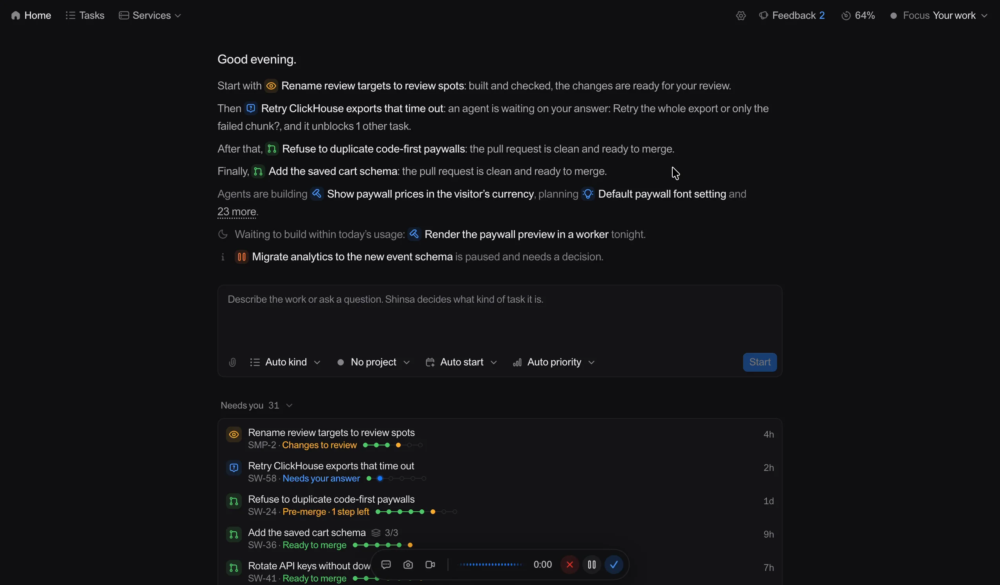

<div align="center">
  <a href="https://shinsa.dev/koe">
    
  </a>

  <h3 align="center">Koe</h3>

  <p align="center">
    Talk to your agents, and show them what you mean.
    <br />
    <a href="https://shinsa.dev/koe"><strong>Learn more »</strong></a>
    <br />
    <br />
    <a href="#introduction">Introduction</a>
    ·
    <a href="#how-it-works">How it works</a>
    ·
    <a href="#download">Download</a>
    ·
    <a href="#development">Development</a>
  </p>
</div>

> [!NOTE]
> **Koe is new.** Version 1.0.0 has just shipped and it works end to end, but it is early software: expect rough
> edges, and features that change from one release to the next. Feedback is very welcome.

<p>
  <a href="https://shinsa.dev/koe">
    
  </a>
</p>

## Introduction

Koe is a menu bar app for your Mac, part of [Shinsa](https://github.com/shinsa-dev/shinsa), for talking to agents.
You speak, and while you speak you comment on what is on screen, take screenshots, record clips and drop in files.
When you stop, Koe copies one bundle: your words, with every attachment placed at the moment you added it. Paste it
into Claude, ChatGPT, Slack or a terminal agent, and the agent reads each screenshot right where you talked about it.

Koe (声) means voice. It transcribes on device, on the Neural Engine, so nothing you say or capture leaves your Mac.
The only things it downloads are the speech model and its own updates.

## How it works

- **Speak.** Press Fn and the pill at the bottom of the screen starts listening straight away. Press it again to
  finish.
- **Comment.** ⌥⇧C freezes the screen; click anything and say what is wrong with it. Koe pins the spot and keeps
  your words with it. ⌘⇧-click does the same from anywhere and starts a session.
- **Screenshot.** ⌥⇧S picks a window or a region, and what you say next becomes its note.
- **Clip.** ⌥⇧R records part of the screen. Play it back slowly, step frame by frame and pick the frames that
  matter.
- **Drop files.** Drag any file onto the pill and it joins the session.
- **One bundle on the clipboard.** Finish, press ⌘V anywhere, and your words and every attachment arrive in order.
  Nothing is lost if Koe quits mid-sentence: the recording is saved as it happens.

Every shortcut can be changed in Settings. How each part works, in full, is [`docs/design.md`](./docs/design.md).

## Download

Koe needs macOS 26 on Apple silicon. [shinsa.dev/koe/download](https://shinsa.dev/koe/download) always fetches the
latest release. For every change as it lands, take the canary:
[shinsa.dev/koe/download/canary](https://shinsa.dev/koe/download/canary) fetches the build of the latest merge to
`main`. Koe updates itself, and Settings switches between Stable and Canary at any time.

The first time you open it, Koe asks for three permissions: the microphone to hear you, screen recording for
screenshots and clips, and Accessibility for the Fn key and ⌘⇧-click. Allowing system audio is optional: it lets
Koe pause music and videos while you talk.

## Development

You need macOS 26 and Xcode 26 or later (Swift 6.2). There is no Xcode project: SwiftPM builds Koe and `build.sh`
assembles and signs the app.

```sh
./build.sh            # builds ./Koe.app
./build.sh --install  # copies it into /Applications and launches it
swift test            # KoeCore's unit tests
```

`build.sh` signs with `KOE_SIGN_IDENTITY` or the first Apple Development certificate in your keychain, so macOS
keeps Koe's permissions across rebuilds. Building, signing, the icon and updates are
[`docs/development.md`](./docs/development.md), the design record is [`docs/design.md`](./docs/design.md), and
how releases are made is [`docs/release.md`](./docs/release.md).
